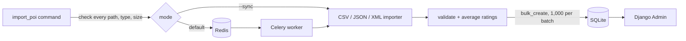

# Location data ingestor

A Django + Celery service that loads point-of-interest (POI) records from CSV, JSON and XML files into a database and lets you browse them in Django Admin. Each file format has its own field names. The ingestor maps all three onto one `PointOfInterest` model, validates coordinates and ratings, and stores the average of each record's ratings.

It is a file-import pipeline with an admin UI, not a search API: there are no public HTTP endpoints besides `/admin/`.

## What it does

- **Three input formats.** It maps them onto one model (field names below).
- **Validation before writing.** Every record is checked before it is saved:
  - latitude must be within ±90 and longitude within ±180;
  - ratings must be finite numbers;
  - model rules apply too: required fields and maximum lengths.
- **Format-specific failure handling.**
  - CSV is forgiving: bad rows are skipped and logged by line number.
  - JSON and XML are all-or-nothing: one invalid record rolls back the whole file.
- **Batched inserts.** Valid records are written with `bulk_create` in batches of 1,000.
- **Two execution modes.** Files are queued to a Celery worker through Redis, or processed in place with `--sync`.
- **Admin browsing.** Search by source ID or generated ID, and filter by category.
- **Input hardening.**
  - The command checks every path, extension and file size (32 MiB maximum) before it queues anything.
  - XML with a DTD or entity declarations is rejected.



## Run it with Docker Compose

Requires Docker with the Compose plugin.

```sh
cp .env.example .env    # then set SECRET_KEY to a long random string
docker compose up -d --build
```

This starts four services:
- Redis;
- a one-shot `migrate` step;
- the admin at <http://127.0.0.1:8000/admin/>;
- a Celery worker.

The web and worker containers share one SQLite file on the `poi-data` volume.

Queue the bundled sample files. They describe an invented harbour town, so none of the places are real:

```sh
docker compose exec web python manage.py import_poi \
  samples/harbour-vale.csv samples/harbour-vale.json samples/harbour-vale.xml
```

```text
3 file(s) submitted to Celery.
```

The worker log (`docker compose logs worker`) shows each task's counts. Here the CSV's blank-name row (line 5) and unparseable ratings row (line 7) are skipped:

```text
WARNING/ForkPoolWorker-1] Skipping invalid CSV line 5
WARNING/ForkPoolWorker-1] Skipping invalid CSV line 7
Task poi.tasks.process_json_file[...] succeeded in 0.01s: {'imported': 3, 'skipped': 0}
Task poi.tasks.process_xml_file[...] succeeded in 0.00s: {'imported': 2, 'skipped': 0}
Task poi.tasks.process_csv_chunk[...] succeeded in 0.02s: {'imported': 4, 'skipped': 2}
```

`--sync` skips the broker and reports counts directly:

```sh
docker compose exec web python manage.py import_poi --sync samples/harbour-vale.json
```

```text
harbour-vale.json: 3 imported, 0 skipped
1 file(s) processed.
```

A bad path stops the whole batch before anything is queued:

```text
$ docker compose exec web python manage.py import_poi --sync samples/missing.csv
CommandError: Every input must be an existing CSV, JSON or XML file
```

To browse the records, create an admin user and sign in at `/admin/`:

```sh
docker compose exec web python manage.py createsuperuser
```

Stop the stack with `docker compose down`. Add `-v` to delete the database volume as well.

### Your own files

The queued path must exist **inside the containers**. Both containers run the same image, so anything under the project folder at build time is visible as a relative path in both, as with `samples/` above. For other files, rebuild the image or mount a directory into both `web` and `worker`.

## Run it in a virtualenv

Python 3.12 (see `.python-version`):

```sh
python3.12 -m venv .venv
source .venv/bin/activate
pip install -r requirements.txt
export DEBUG=true            # or export SECRET_KEY=... (see .env.example)
python manage.py migrate
python manage.py import_poi --sync samples/harbour-vale.csv
python manage.py createsuperuser
python manage.py runserver 127.0.0.1:8000
```

To queue imports instead, start Redis on `127.0.0.1:6379`, or set `CELERY_BROKER_URL`. Then run `celery -A SearchSmartly worker --loglevel=info` in a second terminal.

## Input formats

| Format | Fields | Ratings |
| --- | --- | --- |
| CSV (header row) | `poi_id`, `poi_name`, `poi_category`, `poi_latitude`, `poi_longitude`, `poi_ratings` | quoted and brace-delimited: `"{5,4,3}"` |
| JSON (array of objects) | `id`, `name`, `category`, `coordinates.latitude`, `coordinates.longitude`, `ratings` | number array: `[5, 4, 3]` |
| XML (children of the root) | `pid`, `pname`, `pcategory`, `platitude`, `plongitude`, `pratings` | comma-separated: `5,4,3` |

Extra CSV columns are ignored. Source IDs are kept as strings in all three formats; `cafe-9` and `00042` stay as written. A JSON record with an empty `ratings` array is stored with an average of 0.

## Configuration

All settings come from environment variables. See [`.env.example`](.env.example).

| Variable | Default | Purpose |
| --- | --- | --- |
| `SECRET_KEY` | none | Required unless `DEBUG=true`, which uses a random per-process key (sessions reset on restart). |
| `DEBUG` | `false` | Debug pages; also lets `runserver` serve the admin's static files. |
| `ALLOWED_HOSTS` | `localhost,127.0.0.1,testserver` | Comma-separated. |
| `CELERY_BROKER_URL` | `redis://127.0.0.1:6379/0` | Compose sets `redis://redis:6379/0`. |
| `SQLITE_PATH` | `./db.sqlite3` | Compose sets `/data/db.sqlite3` on the shared volume. |
| `CELERY_TASK_ALWAYS_EAGER` | `false` | Run tasks in-process; `--sync` is the explicit per-command alternative. |

## Project layout

```text
SearchSmartly/     Django project package: settings, URLs, Celery app
poi/
  models/          PointOfInterest
  tasks.py         the three importers and shared validation
  management/commands/import_poi.py
  test_files/      fixtures for the test suite
samples/           fictional files for trying the importer
```

## Tests and lint

```sh
docker compose run --rm --no-deps web python manage.py test poi
```

The suite has 23 tests. They cover:
- CSV skipping rules and batching across the 1,000-row boundary;
- JSON and XML rollback;
- XML DTD rejection;
- command validation and output;
- the sample files' documented counts.

Lint and formatting use [ruff](https://docs.astral.sh/ruff/) (`ruff.toml`):

```sh
pip install -r requirements-dev.txt
ruff check . && ruff format --check .
```

## Design notes and limits

- **CSV streams; JSON and XML do not.** CSV is read row by row with the standard `csv` module, so memory stays flat. JSON and XML are parsed whole, which the 32 MiB cap keeps bounded.
- **Why the formats fail differently.** CSV skips bad rows because large flat exports usually have a few bad lines. JSON and XML roll back the whole file because a broken structured document usually means a broken export.
- **Imports append.** `internal_id` (the source ID) is not unique, so importing the same file twice creates duplicates. A duplicate policy would need a decision about which source wins.
- **Queued jobs report submission, not completion.** There is no result backend or import-history table. Completion and counts are visible only in the worker log. Queuing several files is not atomic: if one dispatch fails, earlier files stay queued.
- **SQLite is shared by two containers.** That is fine for a single-host stack. A multi-worker deployment would want PostgreSQL, which the settings do not configure yet.
- **`runserver` is the web server.** The stack is for local use. A deployment would need a WSGI server and static-file serving.

## License

[MIT](LICENSE)
